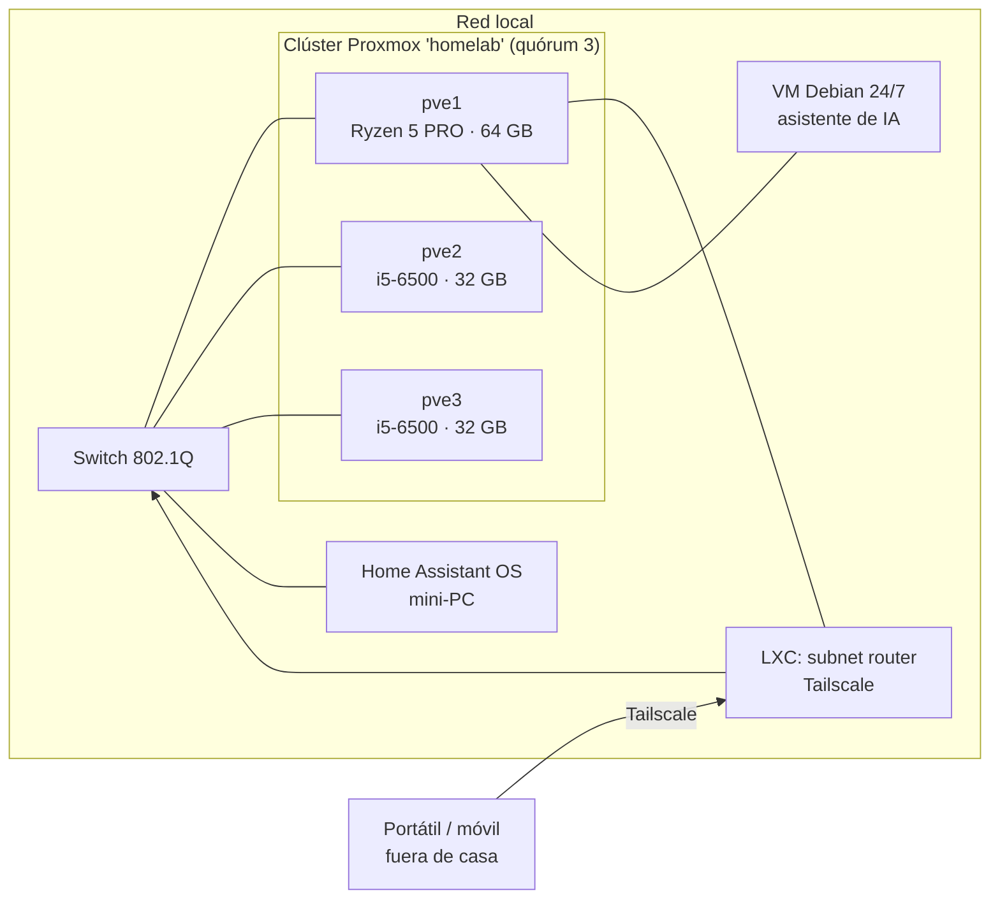

# Arquitectura

## Hardware

| Nodo | Equipo | CPU | RAM | Almacenamiento |
|---|---|---|---|---|
| `pve1` | Lenovo M75s (mini-PC) | AMD Ryzen 5 PRO 5650G | 64 GB (4 × 16 GB) | SSD M.2 256 GB |
| `pve2` | HP EliteDesk 800 G2 SFF | Intel Core i5-6500 | 32 GB (4 × 8 GB) | SSD 500 GB + HDD 500 GB |
| `pve3` | HP EliteDesk 800 G2 SFF | Intel Core i5-6500 | 32 GB (4 × 8 GB) | SSD 500 GB + HDD 500 GB |

- Cada nodo lleva además una tarjeta de red **Intel i210** (1 GbE) en una ranura PCIe x1, reservada para un segundo enlace del clúster.
- Switch gestionable **Tenda TEG208E** (8 puertos, 802.1Q VLAN, solo capa 2).
- Fuera del clúster: un mini-PC con **Home Assistant OS** y un PC de sobremesa reservado para el **NAS** (OpenMediaVault, planificado).

## Diagrama

## Virtualización

- **Proxmox VE 9** en los tres nodos, unidos en un clúster llamado `homelab` (corosync sobre knet, cifrado).
- **Quórum:** con 3 nodos la mayoría es 2, así que el clúster tolera la caída de uno. Con 2 nodos, al caer uno el otro quedaría bloqueado.
- **Segundo enlace de corosync** (por la tarjeta i210, en una red separada): planificado para cuando el switch y el rack estén completos.

## Almacenamiento

| Almacén | Tipo | Dónde | Para qué |
|---|---|---|---|
| `local-zfs` | ZFS (un disco por nodo) | SSD de cada nodo | Discos de VM y contenedores |
| `local` | Directorio | SSD de cada nodo | ISO, plantillas de contenedor |
| `hdd` | Directorio ext4 | HDD de pve2 y pve3 | ISO, plantillas, copias y *snippets* (no discos de VM) |

- El almacén `hdd` **no es compartido**: cada nodo ve solo su disco. Lo compartido de verdad llegará con el NAS (NFS/SMB).
- Los discos de VM van al SSD; el HDD es para copias y material voluminoso.

## Red

- Una red local doméstica; cada nodo se gestiona por su **tarjeta de placa**, no por la i210.
- **Acceso remoto sin abrir puertos:** un contenedor LXC con Tailscale anuncia la red local (*subnet router*), así llego a Proxmox y al resto desde fuera de casa.
- Los nombres de las tarjetas de red están **fijados** (`nic0`, `nic1`, ...) para que no cambien si se mueve una tarjeta de ranura (ver [lecciones](lecciones-aprendidas.md)).

## Máquinas y contenedores

| Nombre | Tipo | Función |
|---|---|---|
| `ts-router` | LXC (Debian 13, 1 núcleo, 512 MiB) | Subnet router de Tailscale |
| `claude` | VM (Debian 13, 4 vCPU, 8 GB) | Asistente de IA 24/7 para documentar y mantener el laboratorio |
